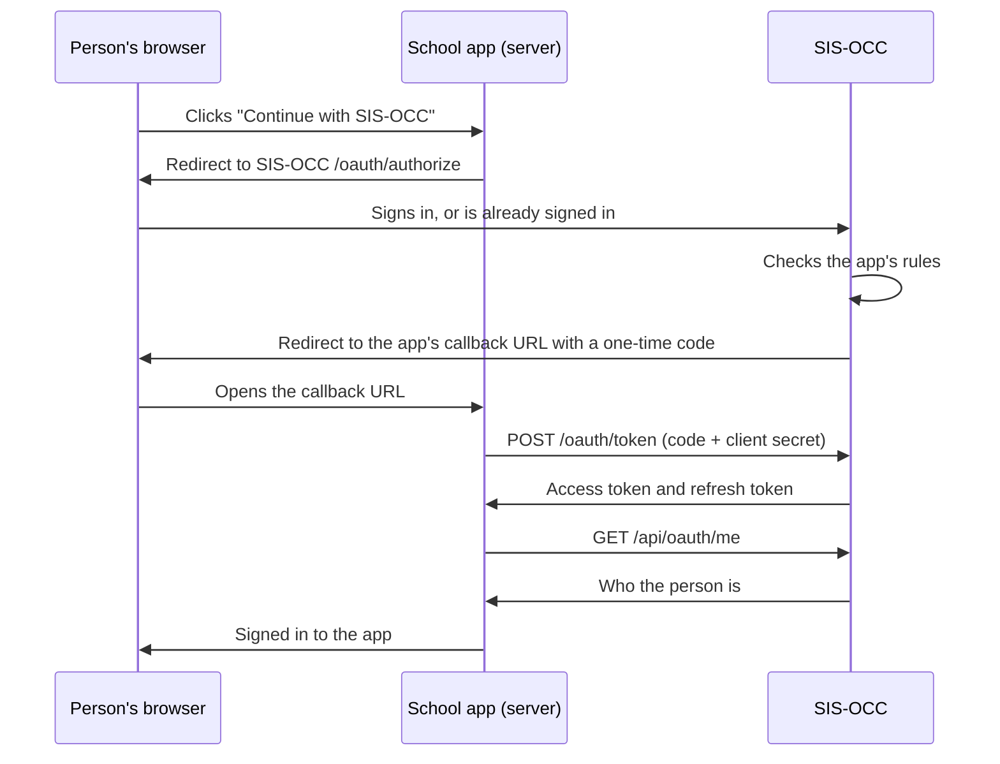

# Continue with SIS-OCC

SIS-OCC can sign people in to the school's other systems, such as a library system or the CSG
election. It works like "Continue with Google": the other app sends the person to SIS-OCC, they
sign in with their SIS-OCC ID number and password, and SIS-OCC tells the app who they are.
The app never sees the password.

SIS-OCC also decides **who may use each app**. The MIS office sets the rules for every app (which
roles may sign in, and whether students must be enrolled this semester), and SIS-OCC checks them
before the app learns anything about the person.

Under the hood it's OAuth 2.0 (the authorization code flow with PKCE), built on Laravel Passport.

## Which guide do I need?

| You are | Read |
|---|---|
| Looking for everything on one page | [The original guide](README.md) |
| MIS staff registering apps or helping someone who can't sign in | [MIS guide](mis-guide.md) |
| Building a web app that signs people in with SIS-OCC | [Web apps](web-apps.md) |
| Building a mobile app (React Native) | [Mobile apps](mobile-apps.md) |
| Testing an app before it goes live | [Development and testing](development.md) |
| Looking up an endpoint, a field or an error | [API reference](api-reference.md) |
| Installing or maintaining the SIS-OCC server | [Server setup](server-setup.md) |

To see the whole flow without setting anything up, open the
[interactive demo](../prototypes/continue-with-sis-occ.html) in a browser. It's a simulation:
nothing in it talks to a real SIS-OCC.

## How a sign-in works

If the person doesn't meet the app's rules, SIS-OCC stops at the rules check. It shows them the
reason, issues no code, and the app only receives `error=access_denied` if they choose to go back.

## Words used in these guides

| Term | Meaning |
|---|---|
| App (client) | A school system registered to use Continue with SIS-OCC |
| Client ID | The app's public identifier, issued by MIS |
| Client secret | The app's password for talking to SIS-OCC from its server. Shown once. |
| Callback URL | Where SIS-OCC sends the browser back after sign-in. Must match a registered URL exactly. |
| Scope | A kind of data the app may read: `profile`, `email` or `enrollment` |
| Code | One-time value in the callback URL that the app swaps for tokens. Works once, expires after 10 minutes. |
| Access token | Lets the app call `/api/oauth/me` for 15 minutes |
| Refresh token | Gets a new access token. Works once, expires after 7 days. |
| `sub` | The person's permanent SIS-OCC account number. Apps link their own accounts to it. |
| PKCE | A one-time proof, created by the app for each sign-in, that makes a stolen code useless |
| Maintainer | Someone MIS allowed to see an app's credentials under **My apps** |

## What SIS-OCC guarantees to apps

- **Only people who meet the app's rules get a code.** Role, active account and, if the app
  requires it, an enrollment record in the school year marked current.
- **The rules are checked again on every `/api/oauth/me` call.** A person who stops qualifying
  is refused from then on, even if the app still holds a token.
- **Status changes end sessions.** Deactivating an account, changing a role, removing an
  enrollment or switching an app off revokes the affected tokens.
- **Apps never receive** passwords, grades, addresses, billing records or parents' details.
- **Every sign-in, blocked attempt and change is recorded** in the SIS-OCC activity log.

## Current limitations

1. **Callback URLs must use http or https.** App schemes such as `occlibrary://` aren't
   accepted, and plain http is only accepted for `localhost`, `127.0.0.1`, `[::1]` and `.test`
   addresses. Mobile apps should sign in through their own backend; see [Mobile apps](mobile-apps.md).
2. **Consent is remembered only briefly.** For apps that aren't marked school-owned, the
   "allow access?" screen comes back once the person's last access token for that app has
   expired (about 15 minutes). School-owned apps never show it.
3. **Every token belongs to a signed-in person.** There's no server-to-server access without a
   person (the client credentials grant isn't enabled).
4. **No OpenID Connect.** There's no ID token or discovery document; apps call `/api/oauth/me`.
5. **Signing out doesn't spread.** Signing out of SIS-OCC doesn't sign people out of other apps,
   and signing out of an app doesn't sign them out of SIS-OCC.
6. **Apps can be switched off but not deleted** from the registry.
